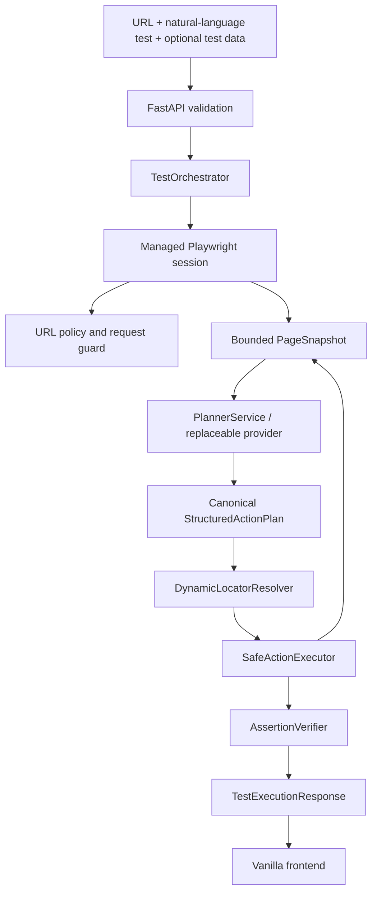

# EBrowserAgent — Living Project Record

This file records the actual implementation and distinguishes offline tests
from browser/provider validation and approval. EBrowserAgent is CloudQA Task 2
and is separate from Task 1, SelfHealingSelenium.

## Project objective

Accept generic plain-English browser tests, create validated structured actions,
execute safe actions in an isolated browser session, and independently verify
the requested outcomes. PHPTravels is a demonstration target, not a hardcoded
workflow. A second unfamiliar public website must also be manually validated.

## Stack and configuration

- Python 3.13, FastAPI, Pydantic 2, async Playwright and Chromium.
- Replaceable async planner protocol; Gemini uses `google-genai>=2.34,<3` and
  Anthropic uses `anthropic>=2.0,<3`; both SDKs are declared in `requirements.txt`.
- Vanilla HTML, CSS, and JavaScript served by FastAPI from the same origin.
- `.venv/` is the project environment; Anthropic SDK 2.6.0 is installed locally.
- `.env.example` lists the Gemini and Anthropic settings, including
  `AI_PROVIDER=anthropic`, both API key placeholders, model names, and provider
  timeouts. `.env` is ignored by Git. Its contents were not inspected or
  modified for this work.

## Architecture and data flow



### Module responsibilities

| Module | Responsibility |
|---|---|
| `app/api/schemas.py` | Bounded requests, discriminated action union, and final response models |
| `app/api/routes.py` | Health route, request-scoped provider, and `POST /api/runs` |
| `app/api/errors.py` | Generic request-validation responses without echoing submitted values |
| `app/planner/provider.py` | Replaceable provider protocol and isolated planning models |
| `app/planner/prompts.py` | Sanitization of instruction/snapshot and provider-safe serialization |
| `app/planner/gemini.py` | Async Gemini JSON output, safe diagnostics, response finish-reason checks |
| `app/planner/anthropic.py` | Async Claude structured JSON output and safe diagnostics |
| `app/planner/factory.py` | Explicit provider selection with no fallback |
| `app/planner/service.py` | Planner boundary, canonical schema validation, value-reference validation |
| `app/browser/manager.py` | Isolated browser lifecycle, cleanup, and validated navigation helper |
| `app/browser/locator.py` | Snapshot-backed semantic targets, one stale refresh, strict ambiguity checks |
| `app/browser/inspector.py` | Bounded, value-free page snapshot extraction |
| `app/execution/executor.py` | Bounded click/fill/select/navigate/wait actions; no generated code execution |
| `app/execution/verification.py` | Independent visible/text/input-value/URL assertion checks |
| `app/orchestration/runner.py` | Bounded plan/execute/replan/verify and final outcome |
| `app/frontend/` | Same-origin static HTML, CSS, and JavaScript interface |

## Milestone statuses

Statuses distinguish implementation from explicit review approval.

### Milestone 1 — Foundation

**Status: COMPLETED AND APPROVED**

FastAPI foundation, request/response/action schemas, settings, requirements,
environment example, `.gitignore`, and initial README.

### Milestone 2 — Browser foundation

**Status: COMPLETED AND APPROVED**

Async Playwright lifecycle, isolated contexts, browser-context URL request
guard, WebSocket blocking, bounded page inspection, and `navigate_page()` for
application-initiated navigation. HTTP(S) targets are validated and
canonicalized; non-global IP addresses and localhost are rejected; DNS
resolution fails closed. Password and input values are excluded from snapshots.
Snapshot URL length is limited to 2,048 characters. These app-level controls do
not eliminate SSRF or DNS rebinding and require network egress restrictions in
production.

### Milestone 3 — Gemini integration and AI planner

**Implementation: COMPLETE. Offline verification: latest reported suite was 202 passing tests (not rerun for this documentation edit). Manual validation: Anthropic smoke test succeeded with a canonical plan and no browser launch.**

Provider abstraction, Gemini async JSON generation, sanitized provider request,
content-bound SHA-256 integrity check, canonical Pydantic validation, action
field bounds, `value_ref` checks, safe diagnostics, and provider cleanup are
implemented. Only test-data keys are sent to the planner; values remain local
to the trusted executor. Sanitization handles bounded literal,
normalization, and encoded forms but is not a complete transform or
process-isolation boundary. The SDK metadata connectivity check succeeded in
prior user-run diagnostics. Gemini generation returned HTTP 503 `UNAVAILABLE`
or timed out; no successful live Gemini generation is claimed. The Anthropic
smoke test used a synthetic snapshot and did not visit a website.

### Milestone 4 — Dynamic locators and safe executor

**Implementation: COMPLETE. Offline verification: included in the latest reported 202-pass suite. Manual validation: PHPTravels navigation and fill passed; this does not establish compatibility with other sites.**

`DynamicLocatorResolver` prefers roles/names, labels, placeholders, exact text,
and allowed attributes. CSS is restricted to simple element or allow-listed
attribute selectors. A missing live match triggers one snapshot refresh;
ambiguous matches fail instead of selecting an arbitrary first result. Browser
timeouts and closed-page/protocol errors are reported as infrastructure
failures, not as ordinary missing elements.
`SafeActionExecutor` reparses every action through the canonical union and
supports click, fill, select, navigate, and bounded time delay. Assertions,
unknown action types, invalid values, and arbitrary code are not executed.
Navigation calls `navigate_page`; referenced values come from the internal
request mapping and are omitted from results.
Interactions bind click, fill, and select to the exact element handle captured
at final semantic resolution. If that node detaches, the action fails rather
than retargeting a replacement. Snapshots expose bounded password type/name/
label metadata but omit current values; literal password fills are rejected
and `value_ref` fills are resolved only by the trusted executor.
Fill targets must be grounded in snapshot metadata. The inspector prioritizes
fillable controls within its bounded element budget, and failed fill-target
lookups are not replanned against unchanged evidence.

### Milestone 5 — Orchestration and verification

**Implementation: COMPLETE. Offline verification: included in the latest reported 202-pass suite. Manual validation: the PHPTravels run completed with PASS / COMPLETED after independent textbox-value verification.**

`TestOrchestrator` validates the target, starts a managed session, inspects,
plans through `PlannerService`, executes, reinspects after actions, and replans
after state changes or recoverable failures up to three times. An unresolved
fill-target lookup stops replanning against unchanged evidence. The executor
bounds successful and failed attempts to 50 total. Each planned action
occurrence has a stable report identity and a separate attempt count; replans
reconcile matching actions one-to-one, so identical actions cannot discharge
multiple obligations. Failed and skipped occurrences remain distinct until
individually completed. The canonical schema requires all actions before
assertions, which are final postconditions checked only after execution
obligations resolve.
PASS requires at least one required assertion and all required assertions
passing. Unresolved actions or unreliable evidence yield INCONCLUSIVE. The
run-wide execution deadline defaults to 300 seconds and is configurable from 1
to 3600 seconds through `EBROWSER_RUN_TIMEOUT_SECONDS`. Browser resource cleanup
and request-scoped provider cleanup each have a validated grace period from 0.1
to 60 seconds through `EBROWSER_CLEANUP_GRACE_SECONDS` (default 5). The run
deadline covers execution; initialized browser resources share one browser
cleanup window, and provider teardown receives a separate window. For
cancellation-cooperative asynchronous cleanup, expected request duration is the
run deadline plus up to those two cleanup windows and framework/network
overhead; cleanup is not included in the run deadline. This is not a hard
process-level maximum. `asyncio.wait_for()` and `asyncio.timeout()` use
cooperative cancellation and cannot forcibly terminate a coroutine that
suppresses cancellation indefinitely. Synchronous code blocking the event loop
can prevent timeout callbacks from running. Stronger termination guarantees
would require process isolation or external supervision, outside this
assignment's current scope. Cancellation propagates after bounded cleanup
attempts when cleanup cooperates.

### Milestone 6 — Frontend and reporting

**Implementation: COMPLETE. Offline verification: included in the latest reported 202-pass suite. The PHPTravels run passed; separate manual frontend walkthrough status is not confirmed here.**

`GET /api/health` and `POST /api/runs` are available under `/api`. The run
endpoint returns a typed final response with action steps and sanitized
assertion evidence. Request fields and test data are bounded. Validation
responses do not echo invalid request values. FastAPI serves the same-origin
vanilla frontend at `/`; it submits a run, shows request status, and renders
the final report without interpolating response values as HTML. Streaming
progress and persistent previous-run history are not implemented.

### Milestone 7 — Readiness, security, and documentation

**Implementation: COMPLETE. Offline verification: latest reported result is 202 passing tests (not rerun for this documentation edit). Second-site validation and successful live Gemini generation remain unverified.**

README and this project record document setup, API usage, architecture,
security boundaries, live validation status, and limitations. `APPROACH.md`
records the implementation strategy. The Milestones 4–7 implementation did
not add dependencies. Later user-run validation succeeded for the Anthropic
planner smoke test and one PHPTravels browser run; no second site or successful
live Gemini generation is claimed.

## Important design and security decisions

- AI output is structured data only, reparsed through Pydantic; there is no
  arbitrary code execution path.
- Planner providers see sanitized instruction/snapshot text and test-data keys,
  never supplied values. The executor resolves `value_ref` locally.
- Semantic locators are preferred. CSS use is deliberately restricted, and
  ambiguous matches are never guessed. Browser infrastructure errors are kept
  distinct from genuine no-match results.
- Execution status is not equivalent to test outcome. Independent assertion
  evidence controls PASS/FAIL/INCONCLUSIVE.
- Each run uses a fresh managed browser context. Initial and application-driven
  navigation use `navigate_page`; requests are checked by the context URL
  guard. Browser-owned network paths and DNS rebinding remain limitations.
- Snapshots omit current input values. The independent verifier can read a
  targeted input value for an `assert_text` check, compares it in memory, and
  omits it from reports/logs. Literal password fills remain rejected; password
  fills use `value_ref`.
- Application-level URL policy is not a substitute for network-level egress
  controls. The current service has no authentication, rate limiting, job
  queue, or public deployment hardening.
- Request and planner error messages are fixed/sanitized. API key and test-data
  values are not returned in reports. The frontend does not persist test data.

## Tests and verification

The current offline suite is run with:

```bash
.venv/bin/python -m unittest discover -s tests -v
```

The latest reported complete offline suite ran 202 tests and passed; this
documentation edit does not rerun it. Tests use mocked providers, SDKs,
Playwright pages, locators, sessions, and URL-policy boundaries. They do not establish real
Playwright/browser compatibility or live Gemini/Anthropic generation. The
inspector's embedded JavaScript is not exercised against a real DOM.

Historical baseline before Milestones 4–7: 84 offline tests passed.
Focused locator/executor, orchestration, API-contract, and verifier test groups
were also run during implementation; the final complete suite is the result
reported above.

## Workspace additions for Milestones 4–7

- `app/browser/locator.py`
- `app/execution/__init__.py`
- `app/execution/executor.py`
- `app/execution/verification.py`
- `app/orchestration/__init__.py`
- `app/orchestration/runner.py`
- `app/api/errors.py`
- `app/frontend/index.html`
- `app/frontend/static/styles.css`
- `app/frontend/static/app.js`
- `tests/test_locator.py`
- `tests/test_executor.py`
- `tests/test_verification.py`
- `tests/test_orchestration.py`
- `tests/test_api_routes.py`
- `APPROACH.md`

Existing M1–M3 planner/browser modules and diagnostic scripts were preserved
for the Milestones 4–7 implementation. The later Anthropic integration added
`app/planner/anthropic.py`, `app/planner/factory.py`,
`scripts/anthropic_planner_smoke_test.py`, and
`tests/test_anthropic_provider.py`; it also updated provider configuration,
API provider construction, dependency declarations, environment template, and
documentation. The root `.env` was not read or modified.

## Manual validation status

Completed:

- Anthropic planner smoke test generated a canonical structured plan from a
  synthetic snapshot; no browser or website was involved.
- PHPTravels at `https://phptravels.net/`: navigation PASS, fill PASS,
  independent textbox-value assertion PASS, overall PASS / COMPLETED.

Still unverified:

1. A second unfamiliar public website.
2. Successful live Gemini generation; previous attempts returned HTTP 503 or
   timed out.
3. A separate manual frontend/health-route walkthrough and any demonstration
   recording.
4. Whether Chromium or other local components still need installation.

No Task 1 project files, credentials, or `.env` contents were used or modified.

## Secondary provider integration — Anthropic Claude

`AI_PROVIDER` selects exactly one provider: `.env.example` sets it to
`anthropic`, while application code defaults to `gemini` if the setting is
absent. Missing Anthropic credentials and unsupported
provider configuration fail safely without fallback. Both adapters use the
same `PlannerService`, retaining canonical Pydantic validation, sanitizer
integrity verification, and test-data value isolation.

The configured Claude model is `claude-haiku-5-5`, selected from Anthropic's
active Haiku line for latency-sensitive, low-cost work. The adapter requests
structured JSON, caps output at 4,096 tokens, uses a 30-second default timeout,
and disables SDK retries. Set `ANTHROPIC_API_KEY` in the backend `.env` or
process environment; process values override `.env`. Keep `.env` out of source
control. Anthropic API billing is separate from Claude.ai subscriptions.

To repeat the one-request synthetic smoke test, configure
`AI_PROVIDER=anthropic` and the key, then run:

```bash
python scripts/anthropic_planner_smoke_test.py
```

The user-run script succeeded and generated a canonical plan. The local
virtual environment reports Anthropic SDK 2.6.0, within the declared
`anthropic>=2.0,<3` range. The smoke test did not launch a browser. Gemini
remains available as an alternative; reported live generation attempts have
returned 503 or timed out.
