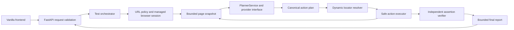

# EBrowserAgent

EBrowserAgent turns a plain-English browser test into a bounded structured
action plan, runs supported actions in an isolated browser session, and checks
the requested outcomes independently. It is designed for different public
websites; PHPTravels is a manual demonstration target, not a hardcoded flow.

## Current status

Milestones 1–7 are implemented in the workspace. Milestones 1 and 2 were
approved previously; Milestone 3 remains implemented and awaiting review.
Milestones 4–7 have offline mock coverage and corrections awaiting independent
review; they still need user-run browser and live provider validation. Previous
Gemini generation diagnostics returned HTTP 503 `UNAVAILABLE` or timed out.
Neither live Gemini nor live Anthropic success is claimed.

## Features

- Natural-language test input and optional key/value test data.
- Replaceable async planner interface; Gemini remains the default, with
  Anthropic Claude as an explicitly selected alternative.
- Canonical Pydantic action validation; generated code is never executed.
- Semantic locator resolution from bounded page snapshots, with explicit
  ambiguity rejection and one stale-snapshot refresh.
- Bounded click, fill, select, navigate, and wait actions.
- Sensitive fill values can be referenced by key and are resolved locally.
- Replanning is bounded; assertions are checked separately from action results.
- Final outcomes are PASS, FAIL, or INCONCLUSIVE. PASS requires every planned
  action obligation to be resolved and every required final assertion to pass.
- FastAPI JSON API and a same-origin HTML/CSS/vanilla JavaScript interface.

## Architecture



Key modules:

- `app/api/schemas.py`: API request/response, action, and report models.
- `app/planner/`: provider-neutral sanitization and plan validation, plus
  asynchronous Gemini and Anthropic adapters.
- `app/browser/`: managed Playwright lifecycle, URL-validated navigation,
  bounded inspection, and `DynamicLocatorResolver`.
- `app/execution/`: `SafeActionExecutor` and independent `AssertionVerifier`.
- `app/orchestration/runner.py`: bounded plan/execute/replan/verify workflow.
- `app/api/routes.py`: health and synchronous run-report endpoints.
- `app/frontend/`: static, same-origin vanilla frontend assets.

The planner receives only a sanitized instruction, sanitized snapshot, and
test-data keys. Actual test-data values remain inside the application and are
available only to the executor when a canonical `value_ref` is used. Planner
output is parsed against the canonical discriminated Pydantic action schema.

## Technology

- Python 3.13
- FastAPI and Uvicorn
- Pydantic 2
- Playwright Python asynchronous API and Chromium
- Google Gen AI Python SDK (`google-genai>=2.34,<3`)
- Anthropic Python SDK (`anthropic>=2.0,<3`) for optional Claude planning
- HTML, CSS, and vanilla JavaScript

The user installs packages and the Chromium binary manually. No packages were
installed during this work.

## Prerequisites and installation

Use Python 3.13 and the project virtual environment. From the project root on
macOS:

```bash
source .venv/bin/activate
python -m pip install -r requirements.txt
python -m playwright install chromium
```

These commands are for the user to run; this implementation did not install
packages or browser binaries.

Copy `.env.example` to `.env`, then set `AI_PROVIDER` to `gemini` (the default)
or `anthropic`. Set only the selected provider's API key in the backend `.env`
or process environment; existing process environment values override `.env`.
Keep `.env` local, server-side, and out of source control. Anthropic API usage
is billed separately from Claude.ai subscriptions.

| Variable | Default | Purpose |
|---|---|---|
| `EBROWSER_APP_NAME` | `EBrowserAgent` | FastAPI application title |
| `EBROWSER_ENV` | `development` | Deployment label |
| `AI_PROVIDER` | `gemini` | Selects exactly one planner provider; no fallback |
| `GEMINI_API_KEY` | empty | Server-side Gemini credential |
| `GEMINI_MODEL` | `gemini-3.8-flash` | Configured planner model |
| `GEMINI_REQUEST_TIMEOUT_SECONDS` | `45` | Planner request deadline |
| `GEMINI_MAX_OUTPUT_TOKENS` | `4096` | Planner output limit |
| `ANTHROPIC_API_KEY` | empty | Server-side Anthropic API credential |
| `ANTHROPIC_MODEL` | `claude-haiku-5-5` | Active, low-cost Claude model |
| `ANTHROPIC_REQUEST_TIMEOUT_SECONDS` | `30` | Anthropic request timeout |
| `EBROWSER_RUN_TIMEOUT_SECONDS` | `300` | Whole-run deadline (1–3600 seconds) |
| `EBROWSER_CLEANUP_GRACE_SECONDS` | `5` | Per-phase cleanup grace window (0.1–60 seconds) for browser resource teardown and provider teardown |

Missing Anthropic credentials or unsupported provider configuration fails
safely without falling back to Gemini. Provider errors do not return
credentials or raw SDK exception text. Gemini remains the default and its
adapter is unchanged.

To manually make one synthetic Anthropic planner request from the project root
with `.venv` activated, set `AI_PROVIDER=anthropic`, configure
`ANTHROPIC_API_KEY`, and run:

```bash
python scripts/anthropic_planner_smoke_test.py
```

The script uses only a synthetic `example.test` snapshot, launches no browser,
and makes one Claude generation request. It was not run during implementation.

## Run the backend and frontend

From the project root with `.venv` activated:

```bash
uvicorn app.main:app --reload
```

Open `http://127.0.0.1:8000/` in a browser. The API and static frontend are
served from the same origin. The user must perform this manual launch and
browser validation; no application or browser was started for this work.

`GET /api/health` returns `{"status":"ok"}`. The frontend submits one
synchronous `POST /api/runs` request and displays the completed report. It
shows a waiting state while the request is running; live per-action streaming
and persistent run history are not implemented.

Example request (use a safe, public target):

```bash
curl -X POST http://127.0.0.1:8000/api/runs \
  -H 'Content-Type: application/json' \
  -d '{
    "target_url": "https://example.com/",
    "instruction": "Open the sign-in form and verify that its heading is visible.",
    "test_data": {}
  }'
```

The response includes a run ID, `COMPLETED` status, final outcome, action
history, and sanitized assertion evidence. Request-validation failures return a
generic message rather than echoing invalid fields or supplied values.

## Example test instruction

> Click the Login button and verify that the login form is displayed.

The planner sees a bounded snapshot and proposes structured actions. The
executor resolves the target from the current snapshot, performs an allow-listed
action, and inspects the page again. Remaining actions are resolved against the
fresh snapshot before execution. After a page change or action failure, the
orchestrator may replan up to three times. Assertions must follow all actions
and are final postconditions checked only after every action obligation is
resolved. A final assertion cannot make an incomplete action sequence pass.

## Outcomes

- **PASS:** At least one required assertion exists and every required
  assertion is independently verified.
- **FAIL:** A required final assertion is demonstrably false, or the initial
  target URL is rejected by policy.
- **INCONCLUSIVE:** The planner, browser, inspection, cleanup, or verification
  cannot establish a reliable result, or the plan contains no required
assertions. Each planned action occurrence has its own report identity, so
repeated identical actions remain separate obligations across replans. An
unrecovered required action failure, an uncompleted planned action, or
expiration of the overall deadline also prevents PASS.

An individual action marked PASS means the browser interaction completed; it
does not establish that the test passed. See the separate assertion results.

## Locator and execution policy

Accessible role/name, label, placeholder, exact text, and a small allow-list of
attributes are preferred. CSS support is limited to a simple tag selector or a
tag plus one supported attribute selector. Positional selectors and arbitrary
CSS/XPath expressions are rejected. A target must have exactly one visible
live match for an interaction; the agent never chooses the first ambiguous
match. A hidden duplicate is handled conservatively as ambiguous at action time.
If the previous snapshot no longer identifies the target, the resolver
re-inspects once and retries. Click, fill, and select use the captured
`ElementHandle` after uniqueness, identity, visibility, enabled, and (for fill)
editability checks. A detached element fails safely instead of retargeting a
replacement. Action reports include an occurrence ID and attempt number so
retries and skipped duplicates remain distinguishable.

Every action is revalidated through the existing Pydantic union. The executor
supports click, fill, select, navigate, and bounded time-based wait. Assertion
actions are reserved for the verifier. AI output is data, never executable
Python, JavaScript, shell, or arbitrary Playwright code. Application navigation
uses `navigate_page`; browser-context HTTP(S) requests pass through the
existing URL guard.

Password controls expose bounded locator metadata such as type and accessible
label, but their current values are never inspected. Password fills require a
`value_ref`; literal fills are rejected, and the referenced value is resolved
only by the backend executor.

## Security considerations

- Only HTTP(S) public destinations are allowed by the application policy;
  embedded credentials, localhost, private, loopback, reserved, and link-local
  addresses are rejected. DNS failures/timeouts fail closed.
- Page content is untrusted planner input. It is bounded, and the prompt
  explicitly rejects webpage instructions as authority.
- Input values are omitted from snapshots. Password fields expose safe locator
  metadata only; their values are not inspected. Test-data values are not sent
  to the planner and are not included in reports.
- Provider diagnostics are allow-listed; raw SDK exception text, response
  bodies, headers, and API keys are not returned to the API client.
- `.env` is ignored by Git. The frontend does not receive either provider key.
- These application-level checks do not eliminate SSRF or DNS rebinding. A
  production deployment needs network-level egress restrictions, a restricted
  browser runtime, and appropriate authentication/rate limits before exposing
  the service publicly.

## Offline tests

Run the offline suite from the project root:

```bash
.venv/bin/python -m unittest discover -s tests -v
```

The suite uses fake providers, pages, locators, and sessions. It does not
launch a real browser or contact Gemini. Mock coverage is not proof of
real-browser compatibility. The embedded page inspector is still not exercised
against a real DOM.

## Known limitations and troubleshooting

- Live Gemini generation has returned HTTP 503 `UNAVAILABLE` or timed out in
  previous manual diagnostics. The planner integration is not live-validated;
  see the safe diagnostic scripts in `scripts/` and run them manually if needed.
- Anthropic generation and its manual smoke test have not been run live.
  Anthropic API use is billed separately from Claude.ai subscriptions.
- A successful live browser run still needs to be tested manually after
  installing Playwright and Chromium.
- Accessible names are a bounded first-pass extraction, not a complete browser
  accessibility-tree implementation. Some custom controls or highly dynamic
  sites may produce INCONCLUSIVE results.
- The app performs one full run per HTTP request, with a 300-second execution
  deadline configurable by `EBROWSER_RUN_TIMEOUT_SECONDS`. Browser cleanup and
  request-scoped provider teardown each receive a cleanup grace window
  controlled by `EBROWSER_CLEANUP_GRACE_SECONDS`; initialized browser resources
  share the browser cleanup window. For cancellation-cooperative asynchronous
  cleanup, expected duration is the execution deadline plus up to two cleanup
  grace windows and framework/network overhead. Cleanup is not part of the
  execution deadline. These are cooperative asyncio deadlines, not a hard
  process-level response-time guarantee: `asyncio.wait_for()` and
  `asyncio.timeout()` cannot forcibly terminate a coroutine that suppresses
  cancellation indefinitely, and synchronous code blocking the event loop can
  prevent timeout callbacks from running. Stronger termination guarantees
  would require process isolation or external supervision, outside this
  assignment's current scope. Client/proxy limits may be shorter. There is no background queue,
  cancellation endpoint, streaming progress, or stored history.
- Wait actions currently represent a bounded delay in milliseconds, not a
  model-selected arbitrary browser wait condition.
- No authentication is implemented. Do not expose the development server to
  untrusted users or the public internet.

If a run is inconclusive, first confirm Python dependencies and Chromium are
installed, the key/model are configured, the website is publicly reachable,
and the required page control is represented in the captured snapshot. A
rejected URL is a policy decision, not a browser failure. Do not disable URL
validation to work around it.

## Manual demonstration checklist

1. Start with the PHPTravels demo site and a short task whose expected state is
   visible, such as opening its login form.
2. Confirm the report distinguishes completed actions from verified
   assertions; record the outcome and any locator limitations.
3. Repeat with a second unfamiliar public site and a different instruction.
   Do not assume that selectors, labels, or login workflows transfer between
   sites.
4. If Gemini generation remains unavailable, record that blocker. Fake
   providers are injected in unit tests only; the application does not expose
   an offline mock-provider demo mode. Do not present mocked results as live.
5. Capture a five-minute walkthrough only after manual checks. The current
   repository contains no live-demo evidence or recording.
