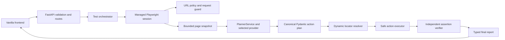

# EBrowserAgent

EBrowserAgent turns a plain-English browser test into a validated plan of
structured actions, executes supported actions in an isolated browser session,
and independently checks the requested outcomes. It works from the page
observations available at runtime; PHPTravels is a demonstration site, not a
hardcoded workflow. The planner returns data, never executable browser code.

## Key features

- Replaceable asynchronous planner providers: Anthropic Claude and Google Gemini.
- Pydantic validation of the plan and each action before execution.
- Bounded page snapshots, semantic locator resolution, and strict ambiguity
  handling. Missing fill targets are not guessed or retried against unchanged
  evidence.
- Supported browser actions: navigate, click, fill, select, and bounded delay.
- Final assertions for visibility, text (including a targeted input or
  textarea value), and URL. Assertions run independently after actions finish.
- Bounded replanning, action accounting, run deadlines, and
  PASS/FAIL/INCONCLUSIVE outcomes.
- FastAPI JSON endpoints and a same-origin vanilla HTML/CSS/JavaScript UI.

## Architecture



Important modules:

| Module | Responsibility |
|---|---|
| `app/api/schemas.py` | Request, action-plan, execution-step, assertion, and response models |
| `app/api/routes.py` | `GET /api/health`, `POST /api/runs`, and request-scoped provider cleanup |
| `app/planner/service.py` | Sanitized provider boundary and canonical plan validation |
| `app/planner/anthropic.py` | Asynchronous Anthropic Messages API adapter and structured output |
| `app/planner/gemini.py` | Asynchronous Gemini structured-output adapter |
| `app/planner/factory.py` | Explicit provider selection; no silent fallback |
| `app/browser/manager.py` | Browser lifecycle and validated application navigation |
| `app/browser/inspector.py` | Bounded extraction of visible text and interactive-element metadata |
| `app/browser/locator.py` | Snapshot-grounded locator construction and ambiguity checks |
| `app/execution/executor.py` | Allow-listed browser actions and safe result reporting |
| `app/execution/verification.py` | Independent final assertion checks |
| `app/orchestration/runner.py` | Run deadline, action tracking, replanning, and outcome calculation |
| `app/frontend/` | Same-origin browser-test form and report display |

The planner receives a sanitized instruction, sanitized page snapshot, and
available test-data keys. Actual test-data values remain inside the application
and are resolved locally by the executor only for a validated `value_ref`.
Provider output is validated against the canonical Pydantic action models
before it can be used. Website text is untrusted observation data, not an
instruction source.

## Technology

- Python 3.13
- FastAPI, Uvicorn, Pydantic 2
- Playwright's asynchronous Python API and Chromium
- `anthropic>=2.0,<3` (Anthropic SDK 2.6.0 is installed in the current local
  virtual environment)
- `google-genai>=2.34,<3`
- Vanilla HTML, CSS, and JavaScript

The dependencies are declared in `requirements.txt`. Install Chromium with
Playwright if it is not already available.

## Installation

From the project root on macOS, create or activate the project virtual
environment, install dependencies, and install Chromium:

```bash
python3.13 -m venv .venv
source .venv/bin/activate
python -m pip install -r requirements.txt
python -m playwright install chromium
```

If `.venv/` already exists, activate it instead of recreating it.

## Environment configuration

Copy the template and edit `.env` locally:

```bash
cp .env.example .env
```

The checked-in template sets `AI_PROVIDER=anthropic`. If `AI_PROVIDER` is
omitted, application code falls back to `gemini`; the factory never silently
switches providers after a configured provider fails. Choose one provider and
set its API key in the backend `.env` or process environment. Process
environment values take precedence. Keep `.env` private, server-side, and out
of source control; never put a key in frontend code or a request to the app.
Anthropic API usage is billed separately from Claude.ai subscriptions.

| Variable | Default | Purpose |
|---|---|---|
| `EBROWSER_APP_NAME` | `EBrowserAgent` | FastAPI application title |
| `EBROWSER_ENV` | `development` | Environment label |
| `AI_PROVIDER` | `anthropic` in `.env.example`; code fallback `gemini` | Selects the planner provider |
| `ANTHROPIC_API_KEY` | empty | Server-side Anthropic credential |
| `ANTHROPIC_MODEL` | `claude-haiku-5-5` | Anthropic model ID |
| `ANTHROPIC_REQUEST_TIMEOUT_SECONDS` | `30` | Anthropic request timeout |
| `GEMINI_API_KEY` | empty | Server-side Gemini credential |
| `GEMINI_MODEL` | `gemini-3.8-flash` | Gemini model ID |
| `GEMINI_REQUEST_TIMEOUT_SECONDS` | `45` | Gemini request timeout |
| `GEMINI_MAX_OUTPUT_TOKENS` | `4096` | Gemini output-token limit |
| `EBROWSER_RUN_TIMEOUT_SECONDS` | `300` | Whole-run execution deadline (1–3600 seconds) |
| `EBROWSER_CLEANUP_GRACE_SECONDS` | `5` | Shared browser cleanup grace and separate provider teardown grace (0.1–60 seconds) |

Anthropic is the selected provider in `.env.example` and the provider used by
the successful manual planner smoke test. Gemini remains implemented as an
alternative, but previous live generation attempts returned HTTP 503
`UNAVAILABLE` or timed out. Successful live Gemini generation has not been
verified.

### Anthropic planner smoke test

With `.venv` activated and Anthropic configured, run from the project root:

```bash
python scripts/anthropic_planner_smoke_test.py
```

The reported manual smoke test generated a canonical structured plan from a
synthetic `example.test` snapshot. It made a planner request but did not launch
a browser or visit a website. This checks planner integration only; it does not
demonstrate browser execution.

## Run the application

From the project root with `.venv` activated:

```bash
uvicorn app.main:app --reload
```

Open `http://127.0.0.1:8000/` for the frontend. The backend serves the UI and
API from the same origin. `GET /api/health` returns `{"status":"ok"}`. The UI
submits one synchronous run request and displays its final report; live
per-action streaming and persistent run history are not implemented.

## API usage

Submit one test with `POST /api/runs`:

```bash
curl -X POST http://127.0.0.1:8000/api/runs \
  -H 'Content-Type: application/json' \
  -d '{
    "target_url": "https://example.com/",
    "instruction": "Open the sign-in form and verify that its heading is visible.",
    "test_data": {}
  }'
```

The request accepts a target URL, a plain-English instruction, and optional
key/value test data. Request validation rejects extra or out-of-bounds fields;
validation errors use a generic response that does not echo submitted values.
The response is a typed report with run status, outcome, action steps, and
sanitized assertion evidence.

## Example test instruction

> Click the Login button and verify that the login form is displayed.

The planner inspects the current bounded snapshot and proposes supported
actions. For fill actions, locator values must match observed snapshot
attributes; the planner is instructed not to invent labels, placeholders, or
accessible names. The executor resolves a unique target, checks that it is
visible and interactable, performs the action, and the orchestrator reinspects
the page. Replanning is limited to three attempts, and total executed actions
are limited to 50. An unresolved fill lookup is not retried against unchanged
evidence.

All browser actions precede assertions. Assertions are final postconditions,
checked only after required action occurrences are resolved. A fill action
marked successful means the interaction completed; it does not prove the
entered value is correct. An `assert_text` directed at an input or textarea
reads that control's current value locally and compares it in memory. The
observed value is not added to reports or logs. Password fields require a
`value_ref`; literal password fills are rejected.

## Outcomes

- **PASS** means at least one required assertion exists, all required
  assertions independently pass, and all planned action obligations have been
  resolved.
- **FAIL** means a required final assertion is demonstrably false or the
  target URL is rejected by URL policy.
- **INCONCLUSIVE** means the result cannot be established reliably, including
  unresolved actions, insufficient evidence (such as a missing target in a
  truncated snapshot that cannot be confirmed by live lookup), planner/browser
  errors, or no required assertion to verify.

Repeated identical action occurrences keep distinct report identities and
must each be resolved. Ambiguous locator matches are not guessed. Assertion
results are separate from action results; an action-level PASS alone never
makes the overall test PASS.

## Security considerations

- The planner emits structured data only. Plans are parsed and validated; the
  application does not execute generated Python, JavaScript, shell commands,
  or arbitrary Playwright code.
- Only HTTP(S) public destinations are allowed by the application URL policy.
  Embedded credentials, localhost, private, loopback, reserved, and link-local
  addresses are rejected; DNS resolution fails closed. Application navigation
  uses `navigate_page`, and browser-context requests are guarded.
- These checks do not eliminate SSRF or DNS-rebinding risk, and do not cover
  every browser-owned navigation/network path. Use network-level egress
  restrictions and a restricted browser runtime for deployment.
- Snapshots omit input values. The verifier may read a targeted input value
  locally to check an assertion but does not report or log it. Test-data values
  are not sent to providers or returned in reports. Provider diagnostics omit
  raw exception messages, response bodies, headers, and credentials.
- The application has no authentication or rate limiting. Do not expose the
  development server to untrusted users or the public internet.
- Cleanup uses cooperative asyncio deadlines, not hard process termination.
  A coroutine that suppresses cancellation indefinitely or synchronous code
  blocking the event loop can exceed the configured grace periods. Stronger
  termination would require process isolation or external supervision.

## Testing and verification

Run the offline unit suite from the project root:

```bash
.venv/bin/python -m unittest discover -s tests -v
```

The latest reported result is 202 passing tests; this README update does not
rerun the suite. Tests use mocked providers, SDKs, pages, locators, and browser
sessions. They do not establish broad real-browser compatibility or verify
live provider generation. The inspector's embedded JavaScript has not been
validated against arbitrary real DOMs.

## Demonstration results

The user-reported Anthropic planner smoke test generated a canonical plan using
a synthetic `example.test` snapshot without launching a browser. The
user-reported PHPTravels browser run at `https://phptravels.net/` completed
successfully: navigation passed, the search textbox was filled with `London`,
an independent assertion verified its value, and the overall outcome was
PASS / COMPLETED. These results do not establish compatibility with other
sites. A second unfamiliar public website has not been confirmed as tested.

## Known limitations

- Gemini generation has not been successfully verified live; prior attempts
  returned HTTP 503 `UNAVAILABLE` or timed out. Anthropic is the provider
  selected by `.env.example` and has a successful reported planner smoke test.
- Locator extraction is bounded and is not a complete accessibility-tree
  implementation. Dynamic or custom controls, truncated snapshots, and
  ambiguous targets may yield INCONCLUSIVE results.
- Wait actions are bounded delays in milliseconds, not arbitrary model-chosen
  browser wait conditions.
- Each API request waits for one run to finish, with a 300-second default
  execution deadline. Browser and provider cleanup each have a separate grace
  window. For cancellation-cooperative cleanup, expected request duration is
  the run deadline plus up to both cleanup windows and framework/network
  overhead; this is not an absolute response-time guarantee. Clients or
  proxies may impose shorter limits. There is no background job queue,
  cancellation endpoint, streaming progress, or persistent run history.
- No second unfamiliar website has been validated, and this project is not
  claimed to be production-ready or universally compatible.

## Demonstration Video

[Watch the EBrowserAgent demonstration](https://drive.google.com/file/d/1OUFUFeuiv2PqR5YHnCS0_Oub2j0NXaqR/view?usp=sharing)
